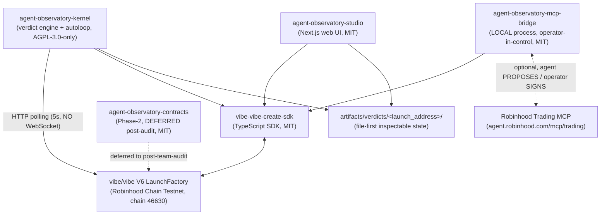

# agent-observatory-kernel

> Verdict engine + autoloop runner for **AgentObservatory** — the tokenized
> agent-observatory on vibe/vibe (Robinhood Chain Testnet). *"The other half
> of the Venn diagram."*

[](https://github.com/0o0r7/agent-observatory-kernel/actions/workflows/ci.yml)
[](LICENSE)

## Table of contents

- [Overview](#overview)
- [Architecture](#architecture)
- [Repository structure](#repository-structure)
- [Quick start](#quick-start)
- [Configuration](#configuration)
- [Usage](#usage)
- [Testing](#testing)
- [Roadmap](#roadmap)
- [Contributing](#contributing)
- [Security](#security)
- [License](#license)

## Overview

The kernel is the AGPL-licensed core of AgentObservatory. It observes every
new token launch on the vibe/vibe V6 LaunchFactory, gathers evidence
(Blockscout API, decoded factory events, creator history, pair-asset
metadata), routes verdict synthesis through a **provider-agnostic LLM
router** with per-role fallback chains, and writes every run to an
inspectable artifact directory.

Core behaviors (per the [autoloop.yml schema](https://github.com/0o0r7/agent-observatory/blob/main/specs/autoloop-yml-schema.md)):

- **Autoloop, not one-shot** — verdict accuracy feeds back into the next iteration.
- **HTTP polling only** — `wss://rpc.testnet.chain.robinhood.com` does not exist; poll at 5s, expose `verdict_block_height`.
- **Evidence over prose** — every verdict carries `evidence_citations`, `commit_hash`, and a standalone `replay.html`.
- **Bonding curve dual-support** — legacy (k=1.0344e6) and current (k=1.0344e9) generations, detected via launch timestamp.

## Architecture

Position of this repository (**highlighted**) within the 5-repo system:



## Repository structure

```text
agent-observatory-kernel/
├── .github/
│   ├── workflows/ci.yml        # lint (ruff) + test (pytest) + build (uv build) + English-only check
│   ├── dependabot.yml          # weekly pip + github-actions updates
│   └── CODEOWNERS
├── docs/                       # links to central docs
├── examples/                   # populated in Phase 1+
├── src/agent_observatory_kernel/
│   └── __init__.py             # Phase-0 hello-world entry point
├── tests/
│   └── test_kernel.py          # Phase-0 pytest suite
├── .env.example                # placeholder env vars (NO real secrets)
├── .python-version             # 3.11
├── LICENSE                     # AGPL-3.0-only (fetched at push time)
└── pyproject.toml              # uv + hatchling + ruff + pytest
```

## Quick start

> Run all installs and builds in **GitHub Codespaces** (see
> [.devcontainer](https://github.com/0o0r7/agent-observatory/tree/main/.devcontainer)). Do not install
> dependencies on a metered/unreliable local connection.

```bash
# Prerequisites: Python 3.11+ and uv (https://docs.astral.sh/uv/)
uv sync                        # creates .venv, installs project + dev deps
uv run pytest                  # run the test suite
uv run python -c "from agent_observatory_kernel import hello; print(hello())"
```

## Configuration

Copy `.env.example` to `.env` and fill in what you need. Never commit `.env`.

| Variable               | Required | Description                                                          |
| ---------------------- | -------- | -------------------------------------------------------------------- |
| `RPC_URL`              | yes      | HTTP RPC endpoint of Robinhood Chain Testnet (WebSocket does NOT exist on this chain) |
| `CHAIN_ID`             | yes      | Chain ID (46630 — Arbitrum Orbit L2)                                  |
| `BLOCKSCOUT_API_URL`   | yes      | Blockscout explorer API base URL                                      |
| `ANTHROPIC_API_KEY`    | no       | Anthropic (Claude) key for the provider-agnostic LLM router           |
| `OPENAI_API_KEY`       | no       | OpenAI (Codex) key for the provider-agnostic LLM router               |
| `ZAI_API_KEY`          | no       | Z.AI (GLM) key for the provider-agnostic LLM router                   |
| `MINIMAX_API_KEY`      | no       | MiniMax key for the provider-agnostic LLM router                      |
| `HUGGINGFACE_TOKEN`    | no       | HuggingFace router token for the provider-agnostic LLM router         |
| `OLLAMA_BASE_URL`      | no       | Local Ollama fallback endpoint (no API key)                           |
| `DISCORD_TOKEN`        | no       | Discord bot token (Phase 7)                                           |

## Usage

Phase-0 scaffold — the kernel service (HTTP polling subscriber, LLM router,
autoloop runner, Brier scoring, replay.html renderer) is implemented in
**Phase 2** per the [phase breakdown](https://github.com/0o0r7/agent-observatory/blob/main/handoff/PHASE_BREAKDOWN.md).

```python
from agent_observatory_kernel import hello

print(hello())  # "AgentObservatory kernel online."
```

## Testing

```bash
uv run pytest          # unit tests
uv run ruff check .    # lint
uv run ruff format --check .
```

## Roadmap

| Phase | Days | Kernel scope |
| --- | --- | --- |
| 0 | 1 | Repo scaffold, CI, license (this commit) |
| 2 | 5-12 | HTTP polling subscriber, LLM router (6 providers / 3 roles), autoloop runner, verdict generation, Brier score |

## Contributing

See [CONTRIBUTING.md](CONTRIBUTING.md). English only in code and docs (CI-enforced).

## Security

See [SECURITY.md](SECURITY.md).

## License

**AGPL-3.0-only** — the kernel is licensed under the GNU Affero General
Public License v3.0 (SPDX: `AGPL-3.0-only`) per the project's
license-split rule: AGPL kernel + MIT adapters. See [LICENSE](LICENSE).
